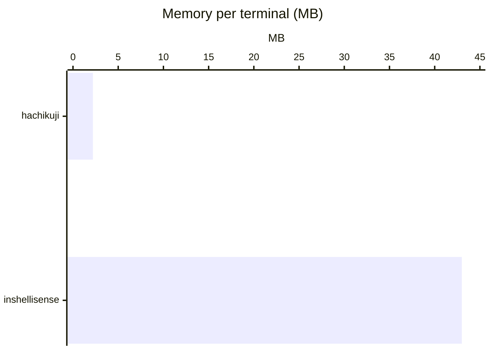
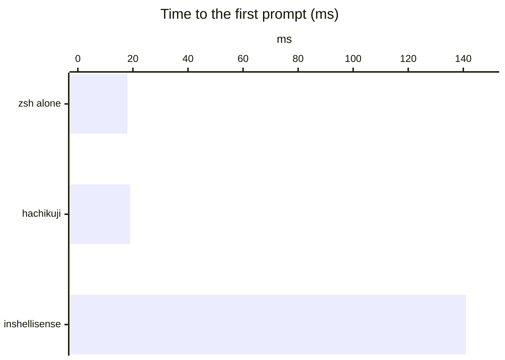
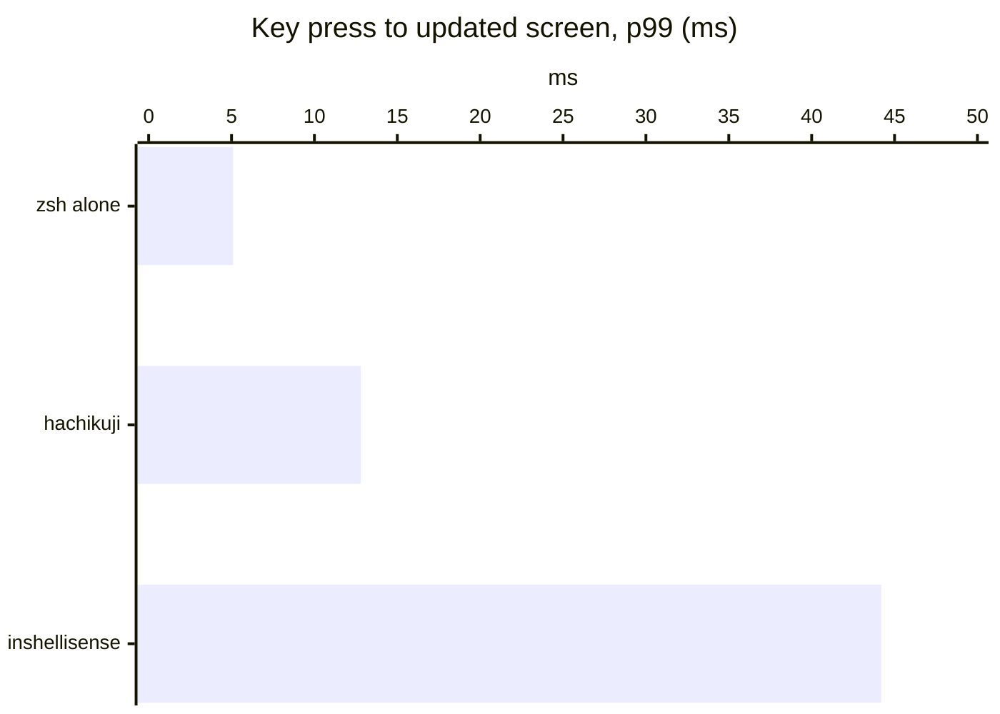

# hachikuji

An IDE-style completion popup for zsh, in the style of Fig and inshellisense, that uses almost no memory.

- **No pty wrapper.** ZLE (the zsh line editor) draws the popup. zsh stays the terminal's foreground process, so Herdr and Ghostty show the right folder after `cd`.
- **About 2 MB per shell.** One small Rust helper per shell. The spec index (14.7 MB, every Fig spec) is a read-only `mmap` file that all shells share. inshellisense uses about 43 MB per terminal.
- **Colors follow the terminal theme.** Only the 16 palette colors, the default colors, and reverse video. When the terminal switches between light and dark, the popup follows with no code and no restart.

## Install

Script (macOS, Linux aarch64; installs to `~/.local`, or to `$PREFIX`):

```sh
curl -fsSL https://github.com/glpecile/hachikuji/releases/latest/download/install.sh | sh
```

Homebrew:

```sh
brew install glpecile/tap/hachikuji
```

Both need the first release to be published.

From source (needs `rustup`, `bun` and `git`; installs to `~/.local`):

```sh
make install
```

Then add the line that `hachikuji init zsh` prints to `~/.zshrc`, **before** zsh-syntax-highlighting (it must load last). Add the printed line, not `eval "$(hachikuji init zsh)"`: the eval would start the binary at each shell start.

```zsh
HACHIKUJI_BIN='/Users/you/.local/bin/hachikuji' source '/Users/you/.local/share/hachikuji/hachikuji.zsh'
```

The helper starts on the first key, not in `.zshrc`.

## Keys

| Key | Popup open | Popup closed |
|---|---|---|
| Up, Down, Ctrl-P, Ctrl-N | Move the selection | The key's own widget (history) |
| Tab | Insert the selected item | The key's own widget (zsh completion) |
| Enter | Insert the item if you moved the selection; else run the line | Run the line |
| Esc | Close the popup (after `KEYTIMEOUT`, 0.4 s by default) | The key's own widget (vi command mode) |
| Right arrow at the end of the line | Accept the zsh-autosuggestions ghost text | Same |

After an insert, hachikuji adds a space (or `/` after a folder) and opens the popup for the next word, so Tab, Tab, Tab builds the line. History recall (Up) opens no popup, so Up keeps walking history. Each key calls the widget that was bound before it, so other plugins' wrappers still run.

## Config

`~/.config/hachikuji/config.toml`. Every key is optional.

```toml
max_rows = 8
border = "rounded"        # rounded | square | none
nerd_font = true          # icons; false colors the name by kind instead
descriptions = true
selected = "reverse"      # "reverse", or a palette index from 0 to 15 (the row background)
```

Default colors: names and descriptions use the default foreground. Borders use palette 8. The icon has the kind color: subcommand 4, option 5, folder 6, command 2.

Palette 8 is not readable as text: 2.5:1 in Catppuccin Mocha and 1.9:1 in Ghostty's built-in Catppuccin Latte. So, unlike the first plan, descriptions do not use it. Contrast of the defaults, in the Catppuccin copies that these dotfiles use:

| | Mocha | Latte |
|---|---|---|
| Names and descriptions (default foreground) | 11.3:1 | 7.1:1 |
| Selected row (reverse) | 11.3:1 | 7.1:1 |
| Border (palette 8) | 2.5:1 | 4.4:1 |

## Numbers

Apple M5, macOS 27, zsh 5.9, full Fig index.

### Compared with inshellisense 0.0.4

Same `.zshrc` (zsh-syntax-highlighting) in a real pty; only the plugin changes. Lower is better.







| | hachikuji | inshellisense |
|---|---|---|
| Processes per terminal | 1 helper, beside zsh | `node` + a pty wrapper, in front of zsh |
| Installed size | 15 MB | 120 MB + Node (149 MB) |

Memory: `footprint` of 12 open terminals (inshellisense: `node` 13 MB + native 30 MB). The other two charts: `python3 tests/vs_inshellisense.py hk|is|base`.

### Hard constraints

| # | Constraint | Target | Measured |
|---|---|---|---|
| 1 | No pty wrapper | zsh is the foreground process | yes; Herdr `hc get` shows `zsh` and its folder |
| 2 | Native only | no JS or Python | one 700 KB Rust binary |
| 3 | Memory per helper | < 4 MB | max 2.14 MB |
| 4a | Latency in the helper | p99 < 16 ms | p99 0.13 ms |
| 4b | Key press to popup | p99 < 16 ms | p99 12.3 ms |
| 5 | Added startup | < 10 ms | 5.3 to 7.8 ms |
| 6 | Fail silent | no hang | a hung helper is killed after 1 s |
| 7 | No network | none | no network code |
| 8 | Platforms | macOS; Linux builds | macOS arm64, x86_64; Linux aarch64 |
| 9 | Theme colors | palette 0 to 15 | SGR 0, 1, 7, 32 to 36, 39, 90 only |

Scripts: `make bench` (4a), `tests/e2e_latency.py` (4b), `tests/startup.py` (5), `tests/memory.zsh` (3), `tests/zsh.zsh` (1, 6, 9). Spec index: 14.7 MB for 1,455 specs.

## How it works

```
zsh (shell/hachikuji.zsh)                       hachikuji serve (Rust, one per shell)
  line-pre-redraw hook ── request (FIFO) ────▶   tokenizer → spec walk → rank → render
  zle -F handler       ◀── response (FIFO) ───   async generators (200 ms timeout, cache)
  POSTDISPLAY + region_highlight                 mmap: specs.idx
```

- **Drawing.** The popup goes in `POSTDISPLAY` after the zsh-autosuggestions ghost text, colored with `region_highlight`. ZLE then handles the bottom of the screen, multi-line prompts and resize. Drawing with escape codes (save cursor, draw, restore) was tried and dropped: at the bottom of the screen it drew a new copy of the rows on each key, and it left rows in the scrollback.
- **Transport.** Two FIFOs in a private folder. zsh opens both read-write, so no open blocks. At most one request is in flight; zsh keeps only the newest pending one. Requests carry a sequence number; older responses are dropped.
- **Helper process.** `setsid()`, so Ctrl-C never reaches it and it is never the foreground process. It ignores SIGINT, SIGTSTP and SIGHUP, runs in `/`, and exits on EOF or EPIPE.
- **Protocol** (version 1). Request: NUL-terminated fields `1 q seq cursor-bytes pwd columns lines selected buffer`. Response: fields separated by 0x1F, ended by 0x1E: `1 seq r count selected replace-chars insert popup-text highlights`. `src/serve.rs` has the details.
- **Widths.** The helper cuts rows to `COLUMNS`. It drops emoji, symbols and zero-width characters from the display: zsh and the terminal disagree on their width, and one disagreement makes ZLE leave old text on screen.

### Things other plugins need to know

- zsh-autosuggestions accepts its ghost text with `BUFFER+=$POSTDISPLAY`. hachikuji removes the popup before the accept widgets run, and adds its widgets to `ZSH_AUTOSUGGEST_IGNORE_WIDGETS`.
- In async mode, zsh-autosuggestions sets `POSTDISPLAY` from a `zle -F` handler, which does not run `line-pre-redraw`. hachikuji wraps `autosuggest-suggest` to put the popup back.
- Ctrl-C is a signal, so no widget and no `zle-line-finish` runs. hachikuji defines `TRAPINT` and `TRAPWINCH` (resize) to clear or redraw the popup. It calls a `TRAPINT` or `TRAPWINCH` function you already have, and it skips a signal that has a string trap.

## Specs

The specs come from [withfig/autocomplete](https://github.com/withfig/autocomplete) (MIT, `specs/FIG-LICENSE`) at commit `aef52acff84c45edde61ae610cc2c964802b9a38`. `make index` builds `build/specs.idx`:

1. `tools/extract.ts` (Bun) reads each spec **without running it**. The TypeScript parser gives the syntax tree, and a small evaluator keeps only literal values: objects, arrays, strings, constants (also imported ones), spreads and simple `.map()` calls. Functions are never called.
2. `hachikuji compile` writes the index: a string table plus fixed-size node records, read in place with `mmap`. Identical child lists are stored once.

What needs JS is dropped and listed in `specs/lost.txt` (268 specs), so it can be ported later. Generators that run `git branch`, `git remote` or `git tag` map to the built-in git generators, and `filepaths()` and `folders()` map to the file and folder templates. Specs that are not static at all (20, for example `cargo`) give no popup.

## Tests

| Command | What it checks |
|---|---|
| `cargo test` | Tokenizer (quotes, pipes, subshells, aliases, cursor in the middle, multibyte, 200,000 random lines), golden spec tests (specs in, lookups out), renderer, protocol, generators |
| `zsh tests/zsh.zsh` | 25 checks on a real zsh in tmux with zsh-autosuggestions, starship and zsh-syntax-highlighting: keys, Ctrl-C, history, bottom of screen, resize, paste, colors, vi mode, foreground process, stopped helper, orphans, and a key-by-key run where the screen must equal a full redraw |
| `python3 tests/e2e_latency.py` | Key press to updated popup (4b) |
| `python3 tests/startup.py` | Startup cost (5) |
| `zsh tests/memory.zsh` | Private memory of 12 helpers (3) |
| `make bench` | Latency inside the helper (4a) |

`spike/` has the Milestone 0 rendering spike (pure zsh, 8 fake items) and its test.

## Limits

- Aliases and `PATH` are read when the helper starts; later changes need a new shell.
- A switch between `bindkey -v` and `bindkey -e` after the first prompt is not seen.
- No popup for commands without a static spec (`cargo`, for example), and no history or usage ranking.
- zsh only. There are no plans for bash, fish or Windows.
