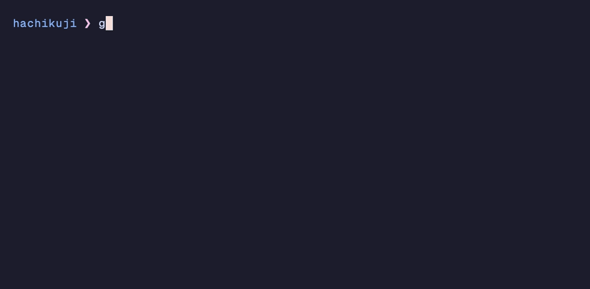
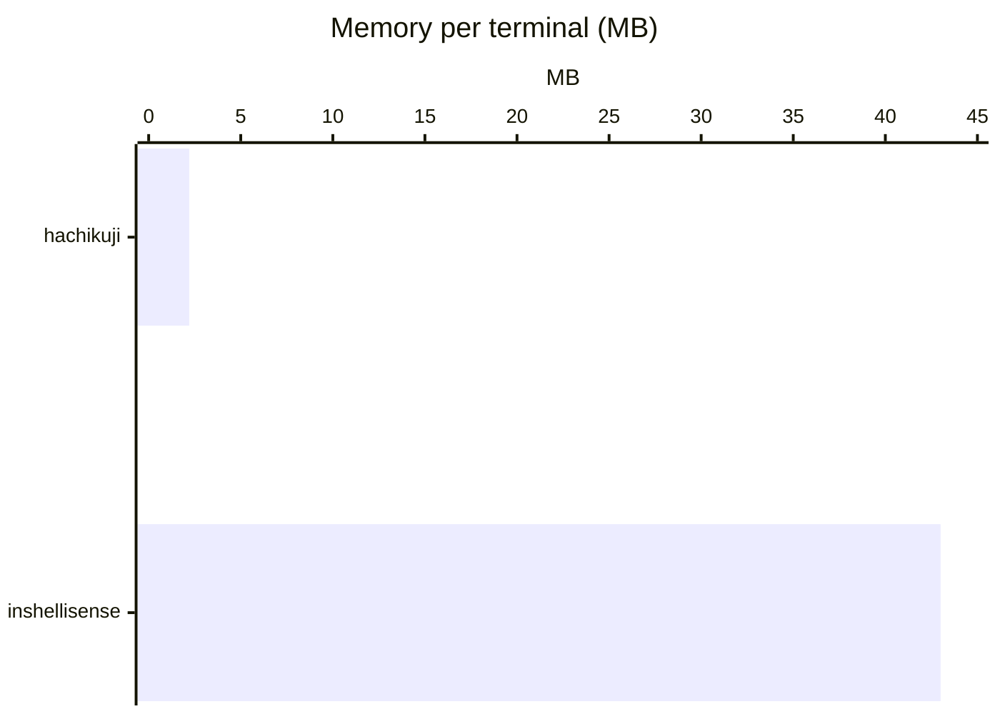
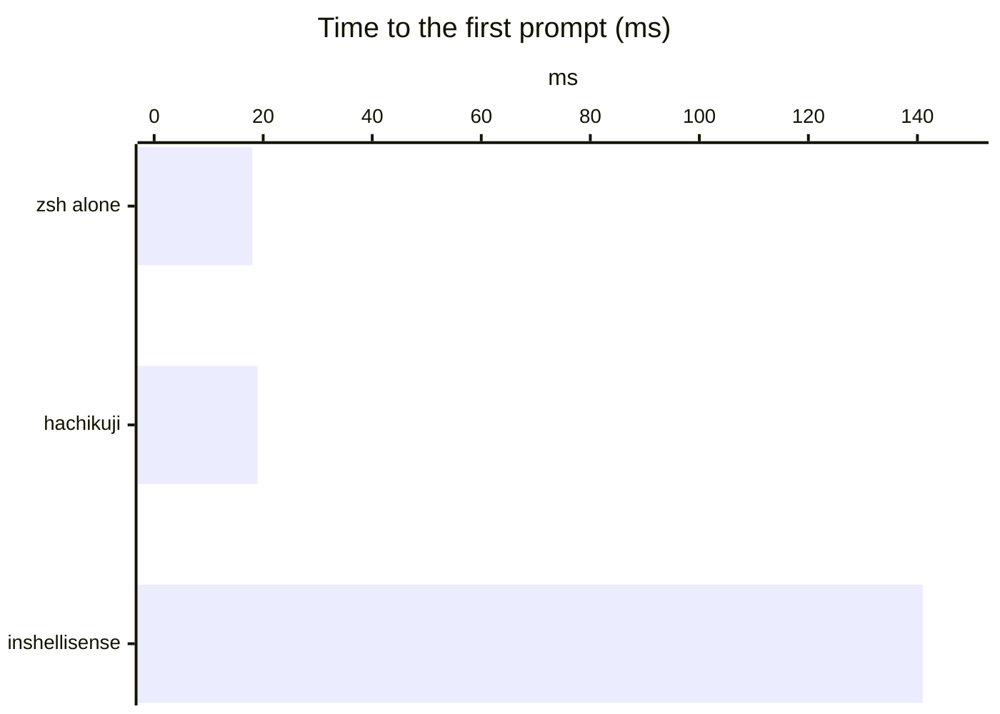
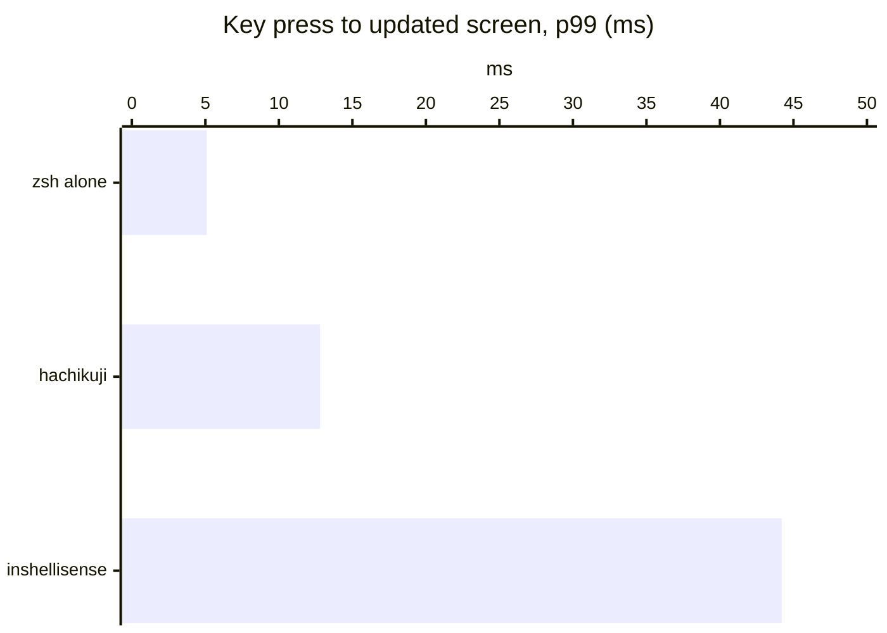

<p align="center"></p>

<h1 align="center">hachikuji</h1>

<p align="center">An IDE-style completion popup for zsh that uses almost no memory.</p>

<p align="center">
  <a href="https://glpecile.github.io/hachikuji">Website</a> ·
  <a href="#install">Install</a> ·
  <a href="docs/MIGRATION.md">Move from Fig, Kiro CLI or inshellisense</a>
</p>

<p align="center"></p>

- **No pty wrapper.** ZLE (the zsh line editor) draws the popup. zsh stays the terminal's foreground process, so Herdr and Ghostty show the right folder after `cd`.
- **About 2 MB per shell.** One small Rust helper per shell. The spec index (14.7 MB, 1,455 Fig specs) is a read-only `mmap` file that all shells share. inshellisense uses about 43 MB per terminal.
- **Colors follow the terminal theme.** Only the 16 palette colors, the default colors, and reverse video. When the terminal switches between light and dark, the popup follows with no code and no restart.

## Install

> **Agents:** to install hachikuji for a user, or to replace Kiro CLI, Amazon Q, Fig or inshellisense with it, follow [docs/MIGRATION.md](docs/MIGRATION.md).

Script (macOS, Linux aarch64; installs to `~/.local`, or to `$PREFIX`):

```sh
curl -fsSL https://github.com/glpecile/hachikuji/releases/latest/download/install.sh | sh
```

Homebrew (macOS):

```sh
brew install glpecile/tap/hachikuji
```

This installs from our own tap, [glpecile/homebrew-tap](https://github.com/glpecile/homebrew-tap), not from homebrew-core. Use the full name, in one command: it adds the tap and trusts the formula. `brew tap glpecile/tap` and then `brew install hachikuji` fails, because Homebrew 7 does not load formulas from an untrusted tap. [docs/RELEASING.md](docs/RELEASING.md#the-homebrew-tap) tells why we have a tap and what it holds.

Then add the line that `hachikuji init zsh` prints to `~/.zshrc`, **before** zsh-syntax-highlighting (it must load last). Add the printed line, not `eval "$(hachikuji init zsh)"`: the eval would start the binary at each shell start.

```zsh
HACHIKUJI_BIN='/Users/you/.local/bin/hachikuji' source '/Users/you/.local/share/hachikuji/hachikuji.zsh'
```

The helper starts on the first key, not in `.zshrc`.

### Update

```sh
hachikuji version   # the installed version
hachikuji update    # install the newest release
```

`update` asks GitHub for the newest release with `curl`. A script install, or a source build installed with `make install`, is replaced in place with release artifacts (macOS or Linux aarch64). A Homebrew install or a binary run from a source checkout prints the command to run instead (`brew upgrade hachikuji`, or `git pull && make install`). Open shells keep the old version until they close.

## Keys

| Key | Popup open | Popup closed |
|---|---|---|
| Up, Down, Ctrl-P, Ctrl-N, Shift-Tab | Move the selection | The key's own widget (Up and Down walk history) |
| Tab | Insert the selected item | Nothing; a second Tab runs the key's own widget (zsh completion) |
| Enter | Insert the item if you moved the selection; else run the line | Run the line |
| Esc | Close the popup (after `KEYTIMEOUT`, 0.4 s by default) | The key's own widget (vi command mode) |
| Right arrow at the end of the line | Accept the zsh-autosuggestions ghost text | Same |

After an insert, hachikuji adds a space (or `/` after a folder) and opens the popup for the next word, so Tab, Tab, Tab builds the line. A fast second Tab waits for that popup (up to 100 ms), so it never starts zsh completion by accident. Some inserts put the cursor in the middle: `git commit --mes` + Tab gives `-m '|'`. History recall (Up) opens no popup, so Up keeps walking history. Each key calls the widget that was bound before it, so other plugins' wrappers still run.

## Config

`~/.config/hachikuji/config.toml`. Every key is optional.

```toml
max_rows = 8
border = "rounded"        # rounded | square | none
nerd_font = true          # icons; false colors the name by kind instead
descriptions = true
selected = "reverse"      # "reverse", or a palette index from 0 to 15 (the row background)
open = "auto"             # "auto": opens as you type; "tab": opens on Tab, then follows typing until it closes
fuzzy = true              # "chk" finds checkout, but only when no name starts with what you typed
```

Default colors: names and descriptions use the default foreground. Borders use palette 8. The icon has the kind color: subcommand 4, option 5, folder 6, command 2.

Palette 8 is not readable as text: 2.5:1 in Catppuccin Mocha and 1.9:1 in Catppuccin Latte. So only the border uses it. Contrast of the defaults in Ghostty's Catppuccin themes:

| | Mocha | Latte |
|---|---|---|
| Names and descriptions (default foreground) | 11.3:1 | 7.1:1 |
| Selected row (reverse) | 11.3:1 | 7.1:1 |
| Border (palette 8) | 2.5:1 | 1.9:1 |

## Numbers

Apple M5, macOS 27, zsh 5.9, full Fig index.

### Compared with inshellisense 0.0.4

Same `.zshrc` (zsh-syntax-highlighting) in a real pty; only the plugin changes. Lower is better.







| | hachikuji | inshellisense |
|---|---|---|
| Processes per terminal | 1 helper, beside zsh | `node` + a pty wrapper, in front of zsh |
| Installed size | 15 MB | 120 MB + Node (149 MB) |

Memory: `footprint` of 12 open terminals (inshellisense: `node` 13 MB + native 30 MB). The other two charts: `python3 tests/vs_inshellisense.py hk|is|base`.

### Hard constraints

| # | Constraint | Target | Measured |
|---|---|---|---|
| 1 | No pty wrapper | zsh is the foreground process | yes; Herdr `hc get` shows `zsh` and its folder |
| 2 | Native only | no JS or Python | one 700 KB Rust binary |
| 3 | Memory per helper | < 4 MB | max 2.19 MB |
| 4a | Latency in the helper | p99 < 16 ms | p99 0.14 ms |
| 4b | Key press to popup | p99 < 16 ms | p99 11.6 ms |
| 5 | Added startup | < 10 ms | 6.4 to 8.0 ms |
| 6 | Fail silent | no hang | writes never block; a hung helper is killed after 1 s |
| 7 | No network | none in the helper | no network code; only `hachikuji update` runs `curl` |
| 8 | Platforms | macOS; Linux builds | macOS arm64, x86_64; Linux aarch64 |
| 9 | Theme colors | palette 0 to 15 | SGR 0, 1, 7, 32 to 36, 39, 90 only |

Scripts: `make bench` (4a), `tests/e2e_latency.py` (4b), `tests/startup.py` (5), `tests/memory.zsh` (3), `tests/zsh.zsh` (1, 6, 9). Spec index: 14.7 MB for 1,455 specs.

## How it works

```
zsh (shell/hachikuji.zsh)                       hachikuji serve (Rust, one per shell)
  line-pre-redraw hook ── request (FIFO) ────▶   tokenizer → spec walk → rank → render
  zle -F handler       ◀── response (FIFO) ───   async generators (200 ms timeout, cache)
  POSTDISPLAY + region_highlight                 mmap: specs.idx
```

- **Drawing.** The popup goes in `POSTDISPLAY` after the zsh-autosuggestions ghost text, colored with `region_highlight`. ZLE then handles the bottom of the screen, multi-line prompts and resize. Drawing with escape codes (save cursor, draw, restore) was tried and dropped: at the bottom of the screen it drew a new copy of the rows on each key, and it left rows in the scrollback.
- **Transport.** Two FIFOs in a private folder. zsh opens both read-write, so no open blocks, and close-on-exec, so child processes do not keep them (the helper exits with the shell). Writes are non-blocking: a FIFO holds 8 KB, and a helper that reads nothing for 100 ms is stopped. At most one request is in flight; zsh keeps only the newest pending one. Requests carry a sequence number; older responses are dropped, and Tab never inserts one.
- **Helper process.** `setsid()`, so Ctrl-C never reaches it and it is never the foreground process. It ignores SIGINT, SIGTSTP and SIGHUP, runs in `/`, and exits on EOF or EPIPE.
- **Protocol** (version 1). Request: NUL-terminated fields `1 q seq cursor-bytes pwd columns lines selected buffer`. Response: fields separated by 0x1F, ended by 0x1E: `1 seq r count selected replace-chars insert popup-text highlights`. `src/serve.rs` has the details.
- **Widths.** The helper cuts rows to `COLUMNS`. It drops emoji, symbols and zero-width characters from the display: zsh and the terminal disagree on their width, and one disagreement makes ZLE leave old text on screen.

### Things other plugins need to know

- zsh-autosuggestions accepts its ghost text with `BUFFER+=$POSTDISPLAY`. hachikuji removes the popup before the accept widgets run: the ones in `ZSH_AUTOSUGGEST_ACCEPT_WIDGETS`, `ZSH_AUTOSUGGEST_EXECUTE_WIDGETS` and `ZSH_AUTOSUGGEST_PARTIAL_ACCEPT_WIDGETS`, and `autosuggest-accept`, `autosuggest-execute` and `autosuggest-partial-accept`. It adds its own widgets to `ZSH_AUTOSUGGEST_IGNORE_WIDGETS`.
- zsh-autosuggestions colors all of `POSTDISPLAY` with its ghost-text style. hachikuji wraps `_zsh_autosuggest_highlight_apply` so that it sees only the ghost text, and the popup keeps its colors.
- In async mode, zsh-autosuggestions sets `POSTDISPLAY` from a `zle -F` handler, which does not run `line-pre-redraw`. hachikuji wraps `autosuggest-suggest` to put the popup back.
- Ctrl-C is a signal, so no widget and no `zle-line-finish` runs. hachikuji defines `TRAPINT` and `TRAPWINCH` (resize) to clear or redraw the popup. It calls a `TRAPINT` or `TRAPWINCH` function you already have, and it skips a signal that has a string trap.

## Specs

The specs come from [withfig/autocomplete](https://github.com/withfig/autocomplete) (MIT, `specs/FIG-LICENSE`) at commit `aef52acff84c45edde61ae610cc2c964802b9a38`. `make index` builds `build/specs.idx`:

1. `tools/extract.ts` (Bun) reads each spec **without running it**. The TypeScript parser gives the syntax tree, and a small evaluator keeps only literal values: objects, arrays, strings, constants (also imported ones), spreads and simple `.map()` calls. Functions are never called.
2. `hachikuji compile` writes the index: a string table plus fixed-size node records, read in place with `mmap`. Identical child lists are stored once.

What needs JS is dropped and listed in `specs/lost.txt` (262 specs), so it can be ported later. Some JS generators map to built-ins of the helper (`BUILTINS` in `tools/extract.ts`):

| Built-in | Used by | Source |
|---|---|---|
| git branches, remotes, tags | `git checkout`, `git push`, ... | `git for-each-ref`, `git remote`, `git tag` |
| git changed files | `git add`, `git restore`, ... | `git status --short` |
| package scripts | `npm run`, `pnpm run`, `yarn run`, `bun run` | the nearest `package.json` |
| make targets | `make` | the Makefile (a `## text` comment is the description) |
| ssh hosts | `ssh`, `scp`, `rsync`, `sftp`, `mosh` | `~/.ssh/config`, `~/.ssh/known_hosts` |
| zoxide folders | `z` | `zoxide query --list` (most used first) |

`filepaths()` and `folders()` map to the file and folder templates, with their `extensions` and `equals` filters (`python3` lists `.py` files). The parser directives `optionsMustPrecedeArguments` and `flagsArePosixNoncompliant` are kept. Specs that are not static at all (20, for example `cargo`) give no popup.

## Development

Build and install from source (needs `rustup`, `bun` and `git`; installs to `~/.local`, or to `PREFIX=...`):

```sh
git clone https://github.com/glpecile/hachikuji && cd hachikuji && make install
```

`make test` runs every check in the table below; `make unit` runs only `cargo test`. To publish a version, follow [docs/RELEASING.md](docs/RELEASING.md).

## Tests

| Command | What it checks |
|---|---|
| `cargo test` | Tokenizer (quotes, pipes, subshells, aliases, cursor in the middle, multibyte, 200,000 random lines), golden spec tests (specs in, lookups out), matching, file filters, quoting, renderer, protocol, generators |
| `zsh tests/zsh.zsh` | 36 checks on a real zsh in tmux with zsh-autosuggestions, starship and zsh-syntax-highlighting: keys (Tab, Enter, Esc, Shift-Tab, two Tabs, `open = "tab"`), Ctrl-C, history, bottom of screen, resize, paste, colors, vi mode, user options, foreground process, a stopped or dead helper, child processes, orphans, and a key-by-key run where the screen must equal a full redraw |
| `python3 tests/e2e_latency.py` | Key press to updated popup (4b) |
| `python3 tests/startup.py` | Startup cost (5) |
| `zsh tests/memory.zsh` | Private memory of 12 helpers (3) |
| `make bench` | Latency inside the helper (4a) |

`spike/` has the Milestone 0 rendering spike (pure zsh, 8 fake items) and its test. The demo GIF comes from [VHS](https://github.com/charmbracelet/vhs): `make && vhs docs/demo/demo.tape`.

## Limits

- Aliases and `PATH` are read when the helper starts; later changes need a new shell.
- A switch between `bindkey -v` and `bindkey -e` after the first prompt is not seen.
- No popup for commands without a static spec (`cargo`, for example), and no history or usage ranking.
- zsh only. There are no plans for bash, fish or Windows.

## License

MIT, see [LICENSE](LICENSE). The specs in `build/specs.idx` come from Fig and keep their own MIT notice in `specs/FIG-LICENSE`.
